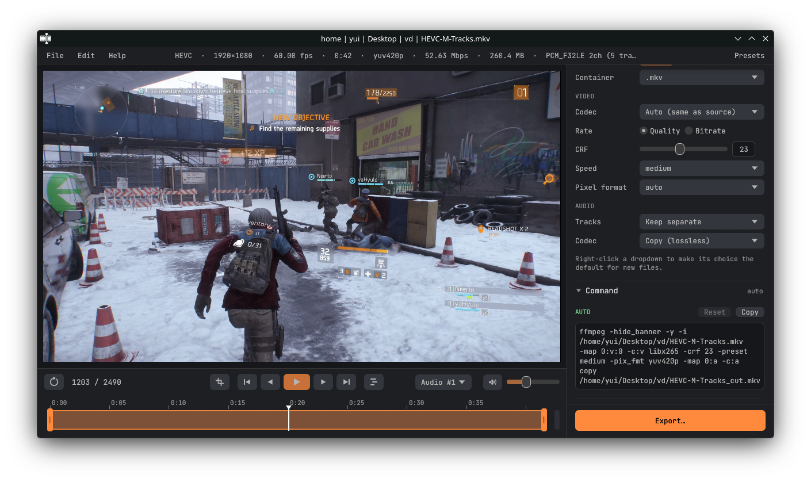

# [](https://github.com/Woysful/FFcut/releases) FFcut - Video Editor

Small and fast wrapper for FFmpeg.

> Heavily vibe coded. Expect issues.

## Features
- Trim
- Crop
- Rotate
- Flip
- Resize
- Video/Audio codecs (CPU, NVENC, AMF, QSV, VAAPI)
- Multi-track audio timeline
- Audio effects per track: fade in / out, volume keyframes, parametric equalizer, compressor, normalization.
- Specific audio track export, or mix all tracks into one
- **Custom FFmpeg command** — the final command is shown and fully editable, and exactly that text is what runs
- Export Presets (edit, import, export)

## Supported Formats

**Input**: anything FFmpeg and mpv can read (MP4, MOV, AVI, MKV, WEBM, FLV, WMV, M4V, ...)

**Output Codecs**:
- Video: H.264, HEVC, VP8, VP9, AV1, ProRes, DNxHD, FFV1, and more (plus hardware encoders)
- Audio: AAC, MP3, Opus, Vorbis, AC-3, FLAC, ALAC, PCM

## Requirements
- **FFmpeg + FFprobe** — found next to the program first, then in `PATH` (or set the paths in *File → Settings*).
- **Linux:** `libmpv2` (`sudo apt install libmpv2` · `sudo pacman -S mpv` · `sudo dnf install mpv-libs`).
- **Windows:** nothing else if you use the zip that includes `libmpv-2.dll` (and FFmpeg if it was bundled).

## 🐧 Installation Linux

### 1. AppImage
 - Download the `.AppImage` from the [release page](https://github.com/woysful/FFcut/releases/latest)
 - Allow it to execute: **Properties -> Permissions -> Execute**, or `chmod +x ./FFcut-*.AppImage`
> It is recommended to use the Gear Lever application for any AppImage installations

### 2. Manual setup
- Download `ffcut-linux-x86_64.tar.gz` from the release page
- Unpack it wherever you like and run `./AppRun`

### 3. Manual building

> **Prerequisites**
> - Rust (https://rustup.rs)
> - libmpv headers: `sudo apt install libmpv-dev pkg-config` · `sudo pacman -S mpv` · `sudo dnf install mpv-devel`
> - FFmpeg (to run it)

```bash
git clone https://github.com/woysful/FFcut.git
cd ./FFcut
./build-linux.sh                    # -> dist/FFcut-<version>-x86_64.AppImage and dist/ffcut-linux-x86_64.tar.gz
BUNDLE_FFMPEG=1 ./build-linux.sh    # also put ffmpeg/ffprobe from this machine inside
```
For a quick run without packaging: `cargo run --release -p ffcut-app`.

#### Wayland and drag & drop
Dragging files into the window does not work on native Wayland (the windowing library, winit, has no support for it yet). Run through XWayland instead: *File → Settings → Display server → X11*, or `ffcut --x11`, or `FFCUT_DISPLAY=x11`. `--wayland` switches back.

## 🪟 Installation Windows

> **Prerequisites**
> - FFmpeg — download [FFmpeg binaries](https://ffmpeg.org/) and place `ffmpeg.exe` and `ffprobe.exe` in `C:\Windows\` or next to `ffcut.exe`,
>   OR put them anywhere and add that folder to `PATH` (skip this if your zip already contains them)

### 1. Manual installing
- Download `FFcut-<version>-windows-x64.zip` from the [release page](https://github.com/woysful/FFcut/releases/latest)
- Unzip it wherever you like and run `ffcut.exe`

### 2. Manual building (on Windows)

> **Prerequisites**
> - Rust with the MSVC toolchain (Visual Studio Build Tools)
> - libmpv dev package (e.g. `mpv-dev-x86_64-*.7z` from [shinchiro builds](https://github.com/shinchiro/mpv-winbuild-cmake/releases)): a folder with `mpv.lib` and `mpv-2.dll`

```bat
git clone https://github.com/woysful/FFcut.git
cd FFcut
set MPV_DIR=C:\libmpv
set FFMPEG_DIR=C:\ffmpeg\bin
build-windows.bat
```
`FFMPEG_DIR` is optional (it bundles ffmpeg/ffprobe into the zip). Result: `dist\FFcut-windows-x64.zip`.

## Keyboard Shortcuts

| key          | Description                         |
|--------------|-------------------------------------|
| Ctrl+O / N   | Import Video                        |
| Ctrl+S / E   | Export Video                        |
| Ctrl+F       | Video Fullscreen (Esc to leave)     |
| F11          | Application Fullscreen              |
|              |                                     |
| Space        | Play/Pause                          |
| ← →          | Previous/Next frame                 |
| , .          | Previous/Next frame                 |
| Shift+← →    | Seek 5 s                            |
|              |                                     |
| Q            | Set trim start                      |
| E            | Set trim end                        |
| R            | Reset Trim                          |
| C            | Toggle crop                         |
| A            | Toggle loop                         |

## Development
- `crates/ffcut-core` — all logic without UI: `model` (export settings), `builder` (settings → ffmpeg argv), `cmdline` (argv ⇄ editable text), `probe` (ffprobe), `run` (runs exactly the argv you see: progress, cancel, cleanup). Tested, including against real ffmpeg.
- `crates/ffcut-app` — the UI (egui + libmpv): `player`, `app`, `update`, `ui/`.
- Tests: `cargo test --workspace` (needs `ffmpeg` in `PATH`).
- The version lives in one place: `[workspace.package]` in the root `Cargo.toml`. Release = bump it, build, publish a GitHub Release tagged `v<version>`.
- Debug env: `FFCUT_DEBUG=1`, `FFCUT_MPV_LOG=file`, `FFCUT_NO_AUDIO=1`, `FFCUT_MPV_DR=auto|yes`, `FFCUT_DISPLAY=x11|wayland`, `FFCUT_UPDATE_URL=<url>`, `FFCUT_NO_UPDATE=1`.
- Fonts: Manrope and JetBrains Mono (OFL), embedded from `crates/ffcut-app/assets/fonts`.

**Main principle:** on export FFcut runs **exactly the text in the command field**. Nothing is filtered or reinterpreted.
